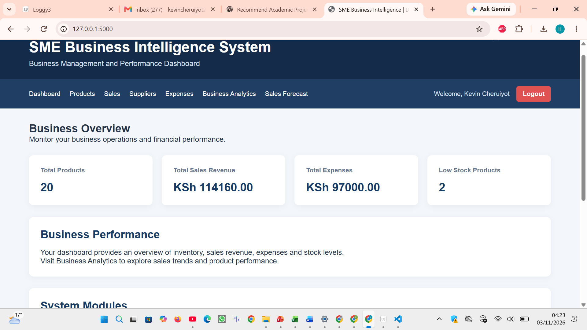
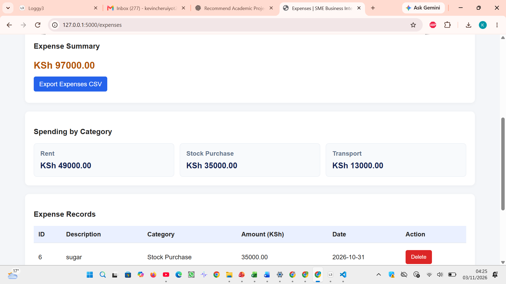
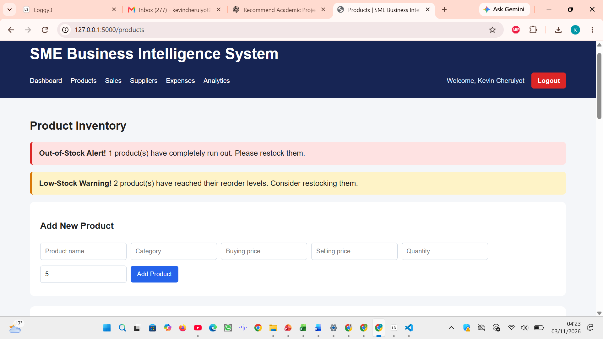
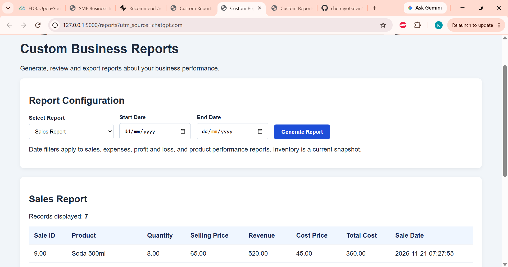
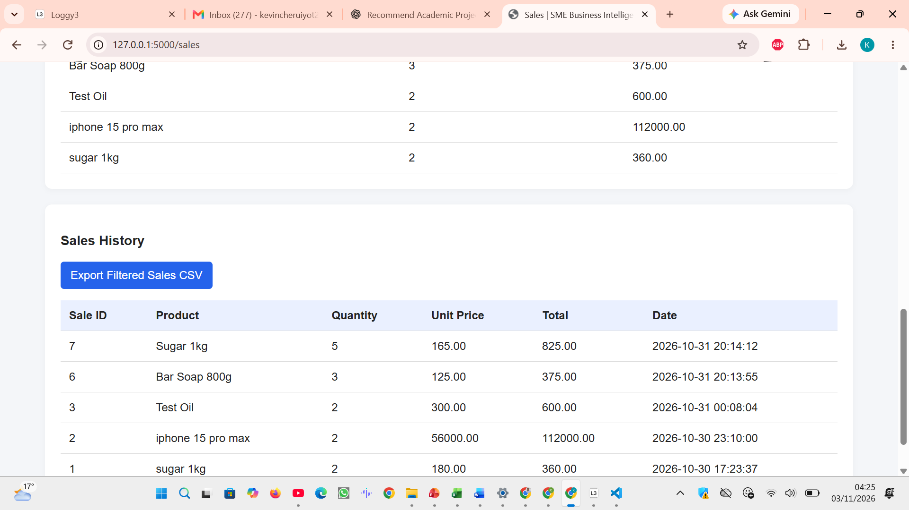
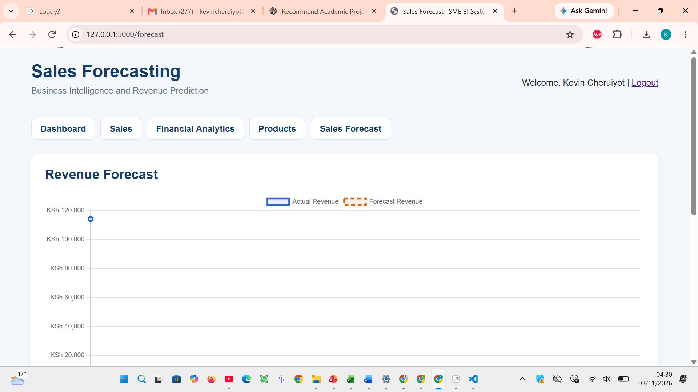
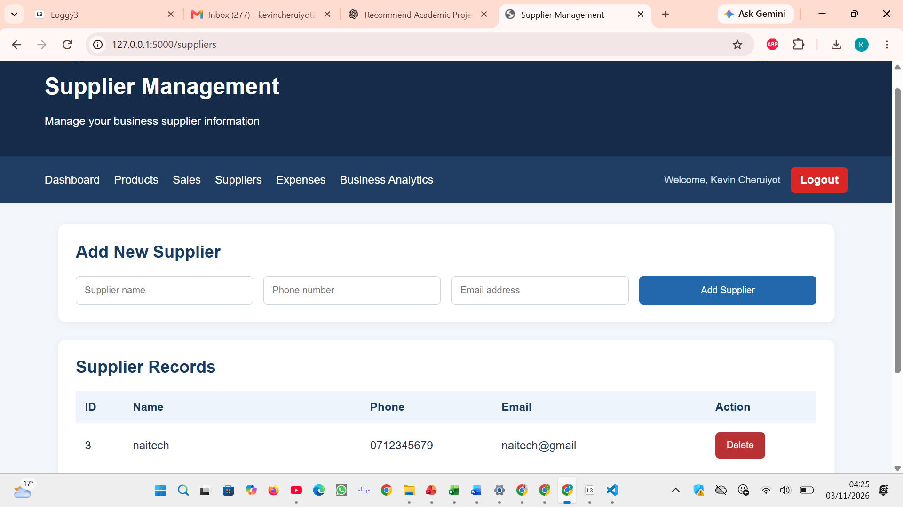

# SME Business Intelligence System

A web-based Business Intelligence and Business Management System designed to help Small and Medium Enterprises (SMEs) manage operations, monitor performance and make data-driven decisions.

## Project Overview

The SME Business Intelligence System provides a centralized platform for managing products, recording sales, tracking expenses, managing suppliers and analysing business performance.

It also includes custom reporting and sales forecasting capabilities.

## Key Features

- **Dashboard:** Overview of business performance using key performance indicators.
- **Product Management:** Add, manage and monitor business products and stock levels.
- **Sales Management:** Record sales and monitor sales revenue.
- **Supplier Management:** Maintain supplier information.
- **Expense Tracking:** Record and monitor business expenses.
- **Business Analytics:** Explore business performance and sales trends.
- **Sales Forecasting:** Analyse historical sales and estimate future revenue.
- **Custom Reports:** Generate sales, profit and loss, expense, inventory and product performance reports.
- **CSV Export:** Download reports for further analysis.
- **User Authentication:** Registration, login and account-specific business records.

## Technologies Used

- Python
- Flask
- SQLite
- HTML5
- CSS3
- JavaScript
- Chart.js

## Project Structure

```text
SME-Business-Intelligence-System/
│
├── app.py
├── database.py
├── requirements.txt
├── README.md
├── .gitignore
│
├── database/
│
├── SCREENSHOTS/
│   ├── analytics.png
│   ├── dashboard.png
│   ├── expenses.png
│   ├── products.png
│   ├── reports.png
│   ├── sales.png
│   ├── salesforecasting.png
│   └── suppliers.png
│
└── templates/
    ├── dashboard.html
    ├── products.html
    ├── sales.html
    ├── suppliers.html
    ├── expenses.html
    ├── analytics.html
    ├── forecast.html
    ├── reports.html
    └── login.html
```

## Installation and Setup

### 1. Clone the repository

```bash
git clone https://github.com/cheruiyotkevin1738/SME-Business-Intelligence-System.git
```

### 2. Open the project folder

```bash
cd SME-Business-Intelligence-System
```

### 3. Create a virtual environment

```bash
python -m venv venv
```

### 4. Activate the virtual environment

Windows:

```bash
venv\Scripts\activate
```

### 5. Install dependencies

```bash
pip install -r requirements.txt
```

### 6. Run the application

```bash
python app.py
```

### 7. Open the application

Visit:

```text
http://127.0.0.1:5000/
```

Register an account to start using the system.

## Database

The application uses SQLite for data storage. The database is initialized by the application.

Each user's business records are associated with their account.

## Screenshots

### 1. Analytics


### 2. Dashboard



### 3. Expenses



### 4. Products



### 5. Reports



### 6. Sales



### 7. Sales Forecasting



### 8. Suppliers



## Project Purpose

This project demonstrates the application of Python, database management, web development and business intelligence concepts to a practical SME business management scenario.